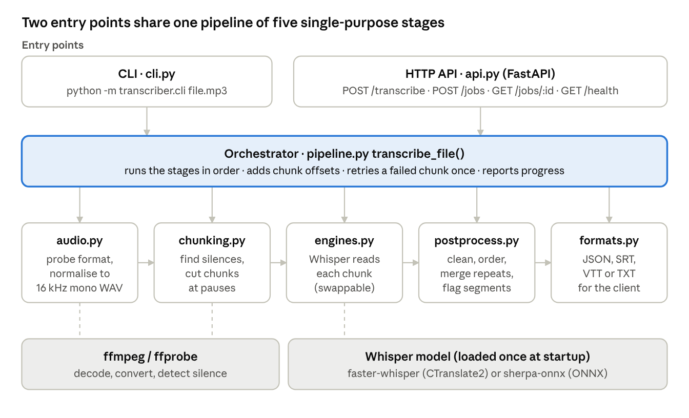
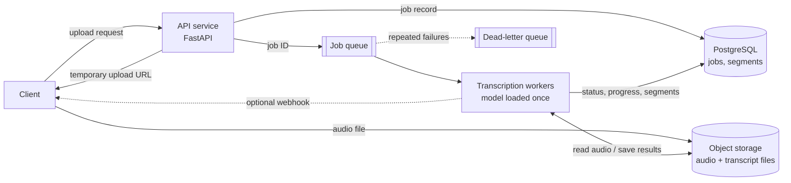

# Transcription Pipeline

A Python service that converts an audio or video file into text with timestamps for each segment,
and returns the result in formats that other systems can use directly (JSON, SRT, VTT, plain text).

It uses a pre-trained open-source Whisper model. The focus is on the engineering around the
model: accepting any format, handling long recordings, producing reliable timestamps, recovering
from failures and exposing everything through a clean API.

```
upload ─► check the file (ffprobe) ─► convert to 16 kHz mono WAV (ffmpeg)
       ─► find silences ─► split into chunks at pauses (silence skipped)
       ─► transcribe each chunk (Whisper) ─► shift timestamps to the original recording
       ─► clean and flag segments ─► JSON / SRT / VTT / TXT
```

---

## Architecture



The design is a layered pipeline. Two thin entry points, the CLI and the HTTP API, call one
orchestrator (`pipeline.py`), which runs five single-purpose stages in order. Only the stages use
external tools: ffmpeg and ffprobe for audio, and the Whisper model for speech recognition.

Read it from the top down: both entry points call the same orchestrator, which passes data from
left to right through the stages. Dashed lines show which stages call outside tools. Because each
stage has one job and the engine is behind an interface, any stage can be tested or replaced on
its own.

---

## Quick start

Requirements: Python 3.10+ and ffmpeg (`brew install ffmpeg` on macOS, `apt install ffmpeg` on Linux).

```bash
python -m venv .venv && source .venv/bin/activate
pip install -r requirements.txt
```

**Command line**

```bash
STT_MODEL=base python -m transcriber.cli samples/stereo_44k.mp3 --format txt
STT_MODEL=base python -m transcriber.cli samples/long_3min.mp3 --format srt -o long.srt
```

**HTTP service**

```bash
STT_MODEL=base uvicorn transcriber.api:app --port 8000

curl localhost:8000/health
curl -F file=@samples/stereo_44k.mp3 "localhost:8000/transcribe?format=json"
curl -F file=@samples/long_3min.mp3 localhost:8000/jobs        # returns a job id (202)
curl localhost:8000/jobs/<job_id>                               # status, progress, result
```

Interactive API documentation is available at `http://localhost:8000/docs`.

**Offline engine (no Hugging Face download)**

```bash
pip install sherpa-onnx
mkdir -p models && curl -L https://github.com/k2-fsa/sherpa-onnx/releases/download/asr-models/sherpa-onnx-whisper-tiny.en.tar.bz2 | tar xj -C models
STT_ENGINE=sherpa-onnx STT_MODEL=$PWD/models/sherpa-onnx-whisper-tiny.en \
  python -m transcriber.cli samples/stereo_44k.mp3 --format txt
```

**Tests**

```bash
python -m pytest -q                                                        # 19 passed, 1 skipped
SHERPA_MODEL_DIR=$PWD/models/sherpa-onnx-whisper-tiny.en python -m pytest -q  # all 20, incl. real model
```

**Docker**

```bash
docker build -t transcriber .
docker run -p 8000:8000 -e STT_MODEL=base -v hf-cache:/root/.cache transcriber
```

### Configuration

All settings are environment variables (`transcriber/config.py`), so the same code runs on a laptop,
a CPU server or a GPU machine.

| Variable | Default | Meaning |
| --- | --- | --- |
| `STT_ENGINE` | `faster-whisper` | Speech-to-text engine: `faster-whisper` or `sherpa-onnx` |
| `STT_MODEL` | `small` | `tiny`, `base`, `small`, `medium`, `large-v3`, or a local model folder |
| `STT_DEVICE` | `auto` | `cpu` or `cuda` |
| `STT_COMPUTE_TYPE` | `int8` | `int8` for CPU, `float16` for GPU |
| `MAX_UPLOAD_MB` | `500` | Maximum upload size |
| `MAX_DURATION_S` | `14400` | Longest recording accepted (4 hours) |
| `SYNC_LIMIT_S` | `600` | Files longer than this must use `/jobs` |
| `MAX_CONCURRENCY` | `1` | Transcriptions allowed to run at the same time |
| `SILENCE_DB`, `MIN_SILENCE_S` | `-35`, `0.4` | What counts as a pause when splitting audio |

---

## Project structure

```text
transcription-pipeline/
├── transcriber/            application package
│   ├── config.py           settings from environment variables
│   ├── audio.py            inspect, convert and read audio (ffprobe / ffmpeg)
│   ├── chunking.py         silence detection and chunk planning for long audio
│   ├── engines.py          speech-to-text engine interface + faster-whisper and sherpa-onnx
│   ├── pipeline.py         orchestrator: runs every stage, retries chunks, fixes timestamps
│   ├── postprocess.py      cleans, orders, de-duplicates and flags segments
│   ├── formats.py          JSON / SRT / VTT / TXT output
│   ├── api.py              FastAPI service: /transcribe, /jobs, /jobs/{id}, /health
│   └── cli.py              command-line entry point
├── tests/                  20 automated tests (pytest)
├── samples/                test audio in many formats
├── examples/               real outputs (JSON and SRT)
├── scripts/make_samples.sh rebuilds samples/ from public LibriSpeech clips
├── requirements.txt
└── Dockerfile
```

Each module has one responsibility and the modules follow the order of the pipeline, so the data
flow can be read file by file. The CLI and the API contain no business logic; both call the same
`transcribe_file()` function, so they always behave the same way.

---

## API (current implementation)

| Endpoint | Purpose |
| --- | --- |
| `POST /transcribe?language=en&format=json\|srt\|vtt\|txt` | Short recordings (up to 10 minutes by default), returned immediately |
| `POST /jobs` → `202 Accepted` + job ID | Longer recordings, processed in the background |
| `GET /jobs/{job_id}?format=...` | Job status (`queued`, `running`, `done`, `failed`), progress in chunks, and the transcript when complete |
| `GET /health` | Confirms the service is running and which engine and model are loaded |

Errors: `400` empty upload, `413` file too large (or too long for `/transcribe`, with a message
pointing to `/jobs`), `415` unsupported or undecodable media.

Example response (abridged):

```json
{
  "text": "God, as a direct consequence of the sin ...",
  "language": "en",
  "duration": 16.715,
  "segments": [
    {"id": 0, "start": 0.0, "end": 6.0, "text": "God, as a direct consequence ...",
     "confidence": 0.91, "flags": []}
  ],
  "metadata": {
    "engine": "faster-whisper", "model": "small",
    "source": {"format": "mp3", "codec": "mp3", "sample_rate": 44100, "channels": 2, "duration": 16.74},
    "chunks": 1, "speech_seconds": 16.3, "failed_chunks": [],
    "processing_seconds": 2.1, "real_time_factor": 0.13
  }
}
```

`confidence` and `language` depend on the engine: the offline English-only model in `examples/`
does not report them, so they are `null` there.

---

## Design decisions – Part 1: the transcription pipeline

### 1. Use a pre-trained Whisper model through faster-whisper

- **Decision:** Whisper, run with `faster-whisper` (CTranslate2), instead of training a model.
- **Why:** open source, multilingual with language detection, robust to accents and background
  noise, and it returns timestamps per segment. faster-whisper is about four times faster than the
  original implementation and runs in `int8` on a CPU or `float16` on a GPU.
- **Settings:** beam search with 5 beams for accuracy, the built-in voice-activity filter to skip
  non-speech, and `condition_on_previous_text=False` to stop Whisper's repetition loops spreading.
- **Trade-off:** larger models (`medium`, `large-v3`) are more accurate but slower; the model is a
  configuration setting, not a code change.

### 2. Keep the engine replaceable

- **Decision:** every engine implements one small interface (`transcribe(audio, sample_rate, language)`
  returning segments with timestamps).
- **Why:** the rest of the pipeline does not depend on Whisper. A hosted API or a different model
  can be added as one new class. The tests use a fake engine, so they run in seconds without a model.
- A second engine, Whisper exported to ONNX and run with `sherpa-onnx`, works fully offline.
  Choose one with `STT_ENGINE`; everything else (formats, chunking, timestamps, outputs) is the same.

| | faster-whisper (default) | sherpa-onnx (offline) |
| --- | --- | --- |
| Model download | Automatic on first run, from Hugging Face | Manual, once, from GitHub (see Quick start) |
| Model names | `tiny`, `base`, `small`, `medium`, `large-v3` | Path to the model folder |
| Languages | Multilingual, detects the language itself | `tiny.en` is English-only |
| Accuracy | Better, especially with `small` and larger | Fine for clear English |
| Internet | Only for the first download, then cached | Not needed after setup |

### 3. Handle every audio format with one conversion step

- **Decision:** convert every input with ffmpeg to 16 kHz, mono, 16-bit PCM WAV, which is the input
  Whisper expects.
- **Why:** WAV, MP3, M4A/AAC, OGG/Opus, FLAC, 8 kHz phone recordings, 44.1/48 kHz stereo music and
  video files all become the same format, so no later step needs format-specific code. For video,
  the first audio track is used.
- **Validation:** the file is inspected with ffprobe before processing. The format is detected from
  the file's content, not its extension, and anything that is not decodable audio is rejected with
  a clear `415` error.
- Uploads are streamed to disk in 1 MB pieces with a size limit, never loaded fully into memory.

### 4. Split long recordings at natural pauses

- **Decision:** detect silences with ffmpeg's `silencedetect` filter and cut the audio into chunks
  inside those pauses, with a small padding so the first and last words are not clipped.
- **Why:**
  - words are never cut in half;
  - silent sections are skipped, which saves processing time and prevents Whisper from inventing
    text on silence (a file of pure silence returns an empty transcript);
  - only one chunk is read into memory at a time, so memory stays flat even for multi-hour files;
  - chunks give progress reporting, independent retries and a natural unit for parallel processing.
- **Fallback:** if speech continues with no pause (music, crowd noise), the cut is made at the
  quietest 50 ms point near the chunk limit.
- **Timestamps:** each chunk's timestamps are shifted by the chunk's start time, so every segment
  refers to its position in the original recording.

### 5. Separate short and long requests

- **Decision:** `POST /transcribe` returns results directly for short files; `POST /jobs` returns a
  job ID immediately for longer files, and `GET /jobs/{id}` reports progress and the result.
- **Why:** an HTTP request should not stay open for many minutes. The model is loaded once at
  startup, a semaphore limits how many transcriptions run at once, and blocking work runs in a
  thread pool so the service stays responsive.

### 6. Isolate failures per chunk

- **Decision:** each chunk is retried once; a chunk that still fails is recorded in `failed_chunks`
  with its time range, and the rest of the recording is still returned.
- **Why:** one problem in a long recording should not discard all the successful work, and the
  user can see exactly which parts are missing.

### 7. Clean and flag the output instead of hiding problems

- Whitespace is cleaned, segments are sorted, and timestamps are kept in order and within the
  recording's length.
- Repeated segments (a known Whisper failure) are merged and flagged `repeated`.
- Segments with low decoder confidence are flagged `low_confidence` for review.
- Text is removed only when the model itself marks it as likely non-speech and the decoding was
  also weak.
- **Why:** downstream systems and reviewers can decide what to do with uncertain output.

### 8. Make it easy to run and test

- Configuration through environment variables, a CLI and an HTTP service sharing one code path,
  and a Dockerfile.
- Tests generate their own audio with ffmpeg and use a fake engine, so they run anywhere.
- Temporary files are always deleted, even when an error occurs.

---

## Design decisions – Part 2: production system design

The prototype runs as a single process with an in-memory job store. In production, I would separate
the API from the transcription workers and use durable storage, so that each part can scale and
recover independently.



### Handling concurrent uploads

I would separate accepting uploads from processing them, so that many users can upload audio
without overwhelming the server or the transcription model.

- Each upload is validated, with file-size and duration limits, and streamed to disk or object
  storage instead of being loaded into memory. Large files can be uploaded directly to object
  storage using a secure, temporary upload URL.
- The API submits a transcription job to a queue and returns a job ID with `202 Accepted`.
- Separate background workers process the jobs, with limits on concurrent tasks based on the
  available CPU, GPU and memory. The model is loaded once per worker, not for every request.
- When many uploads arrive at once, the queue holds the extra jobs until workers are free, and the
  number of workers can be scaled based on queue length.
- Job IDs and idempotency checks prevent duplicate processing when clients retry a request; rate
  limits and per-user quotas stop one user from consuming all resources.
- In the prototype, the same idea is shown with a semaphore that limits concurrent transcription
  and a background job executor.

The API stays responsive while transcription work is processed in a controlled and scalable way.

### Storing audio and transcripts

I would use object storage for audio files and a database for job details, metadata and results.

- **Audio:** Amazon S3, Google Cloud Storage or Azure Blob Storage, holding the original file and, if
  needed, the converted audio. Files are private and encrypted, and accessed through secure,
  time-limited URLs rather than internal storage paths.
- **Database:** PostgreSQL stores the job ID, file location, processing status, audio duration,
  model used, timestamps and any errors, plus the transcript segments with start and end times,
  text and confidence scores.
- **Transcript files:** the complete transcript is also saved as JSON in object storage; SRT and VTT
  files are generated when required.
- **Reprocessing and versions:** the original audio is kept separate from the transcript so it can
  be reprocessed with a different model or configuration. New results are saved as new transcript
  versions instead of overwriting earlier ones, so changes can be tracked and results reproduced.
- **Protection:** retention policies delete files when they are no longer needed, and access
  controls and audit logs protect sensitive data.

Keeping large files apart from structured data makes the system easier to maintain, secure and scale.

### Retrying and recovering failed transcriptions

A failure in one part of the process should not require the whole recording to be processed again.

- **Permanent vs temporary errors:** invalid or unsupported audio is reported immediately; temporary
  problems such as a worker interruption or resource shortage are retried a limited number of times,
  with increasing delays between attempts.
- **Chunk-level recovery:** long recordings are processed in chunks. The current implementation
  retries a failed chunk once, records chunks that still fail and continues with the rest, adjusting
  the timestamps of successful chunks to their positions in the original recording.
- **Job statuses:** pending, processing, completed, partially completed and failed (the prototype uses
  `queued`, `running`, `done` and `failed`).
- **Resuming:** successful chunk results are saved, so an interrupted job resumes from the unfinished
  chunks instead of starting again.
- **Durability:** a durable job queue and progress stored in the database allow unfinished jobs to
  be recovered after a worker crash or restart. Idempotent writes prevent duplicate results, and jobs
  that fail repeatedly go to a dead-letter queue.
- **Visibility:** errors are logged, and failed chunks and their time ranges are reported in the job
  result, so a partial transcript is clearly distinguished from a complete one.

### Exposing the pipeline as an API

The pipeline is exposed through a REST API built with FastAPI, with separate endpoints for short,
synchronous requests and longer, asynchronous jobs.

- `POST /transcribe` accepts an audio file as a multipart upload, validates it and returns the
  transcription as JSON, plain text, SRT or VTT.
- `POST /jobs` returns `202 Accepted` with a job ID; `GET /jobs/{job_id}` reports status and progress
  and returns the transcript when processing is complete.
- `GET /health` confirms the service is running.
- Clear status codes and messages: `400` empty request, `413` upload over the size limit, `415`
  unsupported or undecodable media.

For production use I would add:

- API versioning (for example `/v1/...`), authentication, rate limiting and structured logging;
- the automatically generated OpenAPI documentation that FastAPI provides;
- direct uploads to secure object storage through temporary upload URLs for large files;
- webhooks that notify clients when a job completes, so they do not need to keep checking;
- access rules so users can see only their own jobs and transcripts, and secure ways to retrieve or
  delete results.

This gives client applications a clear interface, supports both short and long recordings, and lets
the API and the transcription workers scale independently.

---

## Testing and results

`python -m pytest -q` runs 20 tests covering format conversion, content-based format detection,
rejection of non-audio files, silence detection, chunk planning, forced cuts, absolute timestamps
across chunks, chunk retry and failure reporting, post-processing, subtitle formats, the HTTP API
and job flow, and the faster-whisper adapter (with a mocked model). One end-to-end test uses a real
Whisper model and runs when `SHERPA_MODEL_DIR` is set.

Real-model results (Whisper tiny.en via sherpa-onnx, 2 CPU cores), inputs from `scripts/make_samples.sh`:

| Input | Result |
| --- | --- |
| 16 kHz WAV, 8 kHz WAV, 44.1 kHz stereo MP3, M4A (AAC), OGG (Opus), MP4 video | Correct text with segment timestamps |
| 10 seconds of silence | Empty transcript, no invented text |
| 4.2-minute MP3 | 17 chunks, 40 segments, timestamps matching the known clip boundaries; processed in 26 s (0.10 × real time) |
| Text file renamed to `.mp3` | Rejected with HTTP 415 |

## Limitations

- Jobs are stored in memory, so they are lost if the service restarts (addressed by the Part 2 design).
- One process handles both the API and transcription; production would separate them.
- The small offline model is English-only and makes occasional spelling mistakes on names; larger
  models improve accuracy at the cost of speed.
- No authentication, speaker identification or word-level timestamps yet.

## Next steps

Speaker diarization, word-level timestamps, language detection per chunk for mixed-language audio,
GPU batching, real-time streaming over WebSocket, PII redaction before storage, and tracking word
error rate on a labelled test set for each language.

## Sample data

The speech in `samples/` comes from three clips of the [LibriSpeech](https://openslr.org/12) corpus
(read audiobook speech from LibriVox, licensed CC BY 4.0), as shipped with the sherpa-onnx Whisper
model. `scripts/make_samples.sh` converts them into each supported format and builds the silence,
non-audio and long-recording test files.
